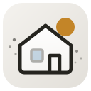
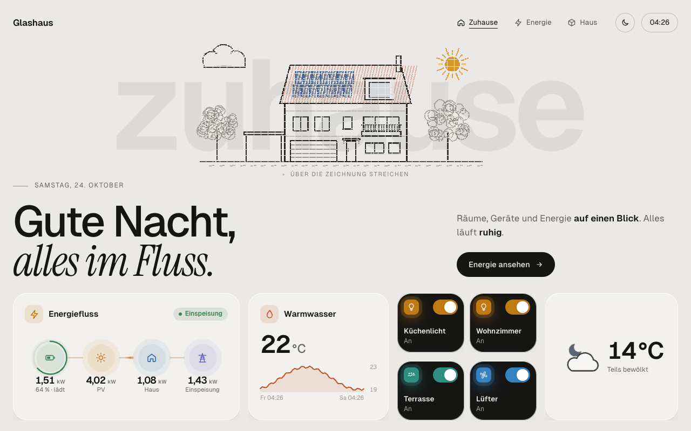
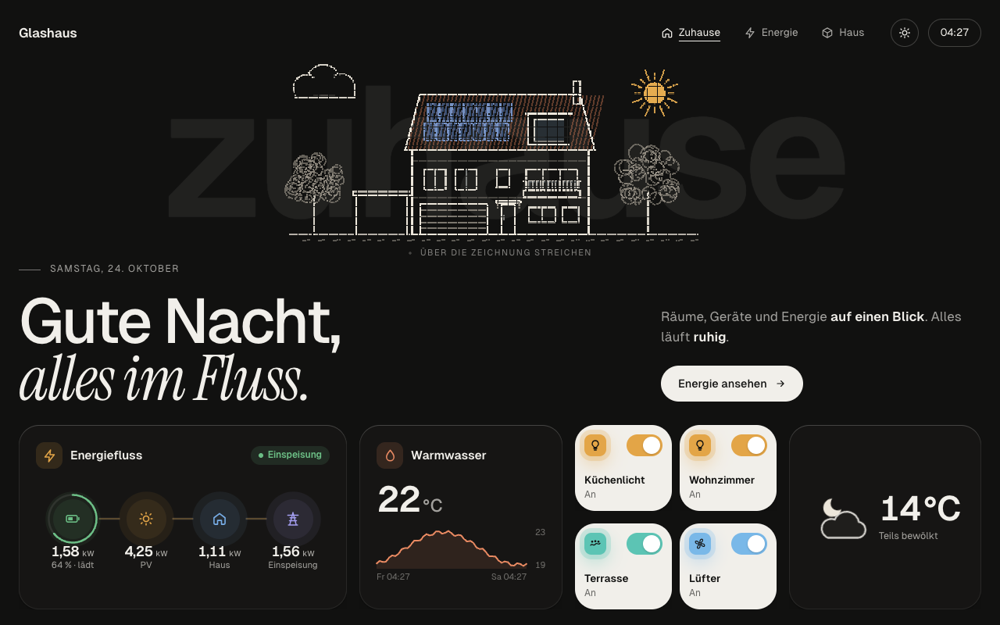
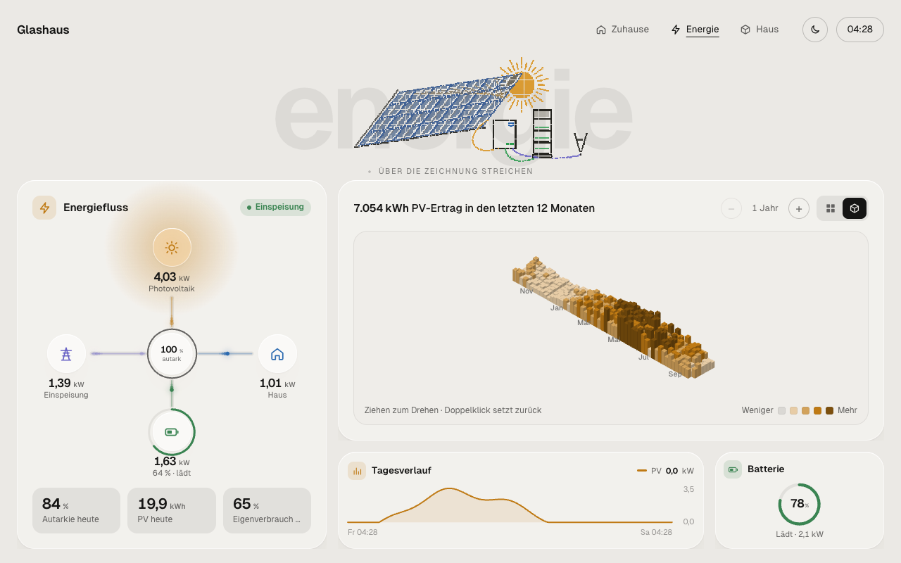
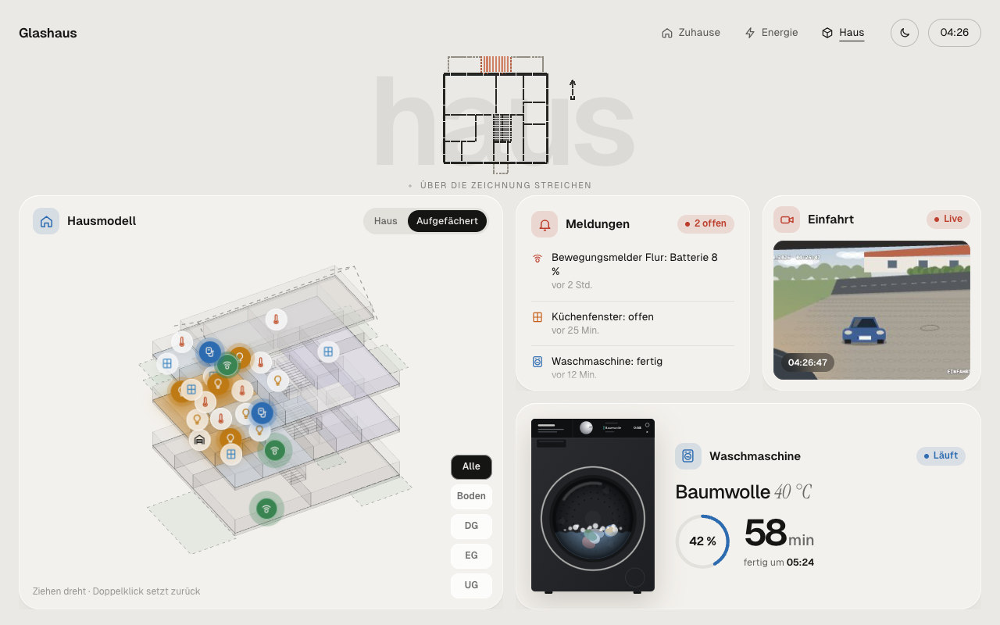
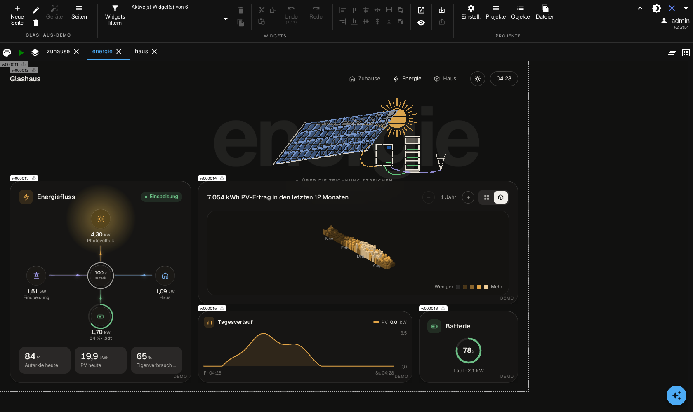

# ioBroker.vis-2-widgets-glashaus

**Glashaus** is a calm, glass-like design for [ioBroker vis-2](https://github.com/ioBroker/ioBroker.vis-2):
frosted glass cards, large typography with a serif italic accent, light and dark, and line drawings in the
background that dissolve into particles when you touch them. It is made for wall tablets and works in any browser.

The widgets are generic: you pick your own object IDs in the vis-2 editor. Until you do, every widget shows
lively demo values, so you can lay out a page first and connect it afterwards.

| Dark | Energy | House |
|---|---|---|
|  |  |  |

The pictures show the included demo project in vis-2 (1280 × 800, demo values).
Static preview of the design in any browser: <https://djlex83.github.io/glashaus-vis2/>

German documentation: [docs/de/README.md](docs/de/README.md)

## Widgets

| Widget | What it does |
|---|---|
| **Background** | Full-view background: warm beige or dark, a huge backdrop word and a line drawing (house, energy, heating, appliances, driveway, floor plan or your own image) that dissolves into particles under the finger. The house can show the weather. |
| **Header** | Greeting by time of day, a second line in serif italic, a short text, clock and buttons to other views. |
| **Navigation** | Brand, links to your views (active one underlined), theme toggle, clock and a status pill. |
| **Value** | Glass tile with icon, title, animated value, unit, status pill by thresholds and a 24 h line from history. |
| **Switch** | Switch tile that turns to ink when on; button and scene modes, optional dimmer. |
| **Ring** | Circular gauge for percentages such as battery state of charge. |
| **Status list** | Up to 20 conditions as rows or as a list of active messages ("All fine" when nothing is active). |
| **Energy flow** | PV, house, battery, grid, wallbox and one extra consumer with animated flow, battery ring and autarky. |
| **Chart** | Up to four series from your history adapter as lines or as bars per hour, day, week or month. |
| **Year skyline** | A year of daily values as an isometric 3D skyline (PV yield, consumption, heating …), several years as stripes. |
| **Weather** | Current weather with an animated icon, values and an optional 24 h and 7 day forecast. |
| **Appliance** | Animated washing machine, dryer or dishwasher with progress ring, remaining time and "done" state. |
| **Camera** | Snapshot camera with refresh, live pill, motion pill and a large view on click. |
| **House model** | Isometric 3D glass house from a floor plan in meters, with lights, windows, motion and thermostats on their places. |

## Installation

The widget set needs **vis-2 2.20 or newer** and the **web** adapter.
Install it in the ioBroker admin under *Adapters* (search for "glashaus"). New adapters start in the *latest*
repository; switch the repository to *latest* in the admin settings if the widget set is not listed yet.

vis-2 restarts automatically; the widgets appear in the palette under **Glashaus**.

## Demo project

[`examples/glashaus-demo.zip`](examples/glashaus-demo.zip) is a ready vis-2 project with three views for a wall
tablet (1280 × 800): **Zuhause** (home), **Energie** (energy) and **Haus** (house), 22 widgets in total.
Import it in the vis-2 editor: *Projects* → *Import* → choose the zip → name it e.g. `glashaus-demo`.
All widgets run with demo values; select your own object IDs in the attributes of each widget.

## Getting started

1. Create a view and put the **Background** widget on it. Set its size to `100%` × `100%` and position `0`/`0`
   (it is the default) and send it to the back.
2. Add **Header** and **Navigation** at the top, then tiles such as **Value**, **Switch**, **Energy flow**.
3. Every widget has the group **Design**: *Theme* (like vis-2, light, dark, like the device), *Glass card* and
   *Fade-in animation*. "Like vis-2" follows the vis-2 theme, which the theme toggle of the Navigation widget switches.
4. Charts, the year skyline and the value tile read from your history adapter (history, influxdb or sql).
   The instance can be chosen per widget; default is the system default history.

The editor and the widgets are translated into English, German, Russian, Portuguese, Dutch, French, Italian,
Spanish, Polish, Ukrainian and Chinese.

## Privacy

The fonts (Geist and Instrument Serif, SIL Open Font License) are shipped with the widget set. Nothing is loaded
from external servers.

## Development

See [DEVELOPMENT.md](DEVELOPMENT.md): structure, rules, how to add a widget, the harness to develop widgets
without ioBroker, and the vis-2 test.

## Contributing

The widget set is actively developed. Bugs and ideas are welcome as
[issues](https://github.com/djlex83/ioBroker.vis-2-widgets-glashaus/issues), code as pull requests – see
[CONTRIBUTING.md](CONTRIBUTING.md). Every pull request is reviewed (AI-assisted) and the maintainer decides whether it
is merged; the Glashaus design stays the same for all widgets. If you work with an AI coding assistant, it finds the
project rules in [AGENTS.md](AGENTS.md) and `.claude/skills/glashaus-widgets/`.

## Changelog

<!--
    Placeholder for the next version (at the beginning of the line):
    ### **WORK IN PROGRESS**
-->

### 0.1.0 (2026-10-23)

- (djlex83) First release with 14 widgets: background, header, navigation, value, switch, ring, status list,
  energy flow, chart, year skyline, weather, appliance, camera and 3D house model

## License

MIT License

Copyright (c) 2026 djlex83 <djlex83@users.noreply.github.com>

Permission is hereby granted, free of charge, to any person obtaining a copy
of this software and associated documentation files (the "Software"), to deal
in the Software without restriction, including without limitation the rights
to use, copy, modify, merge, publish, distribute, sublicense, and/or sell
copies of the Software, and to permit persons to whom the Software is
furnished to do so, subject to the following conditions:

The above copyright notice and this permission notice shall be included in all
copies or substantial portions of the Software.

THE SOFTWARE IS PROVIDED "AS IS", WITHOUT WARRANTY OF ANY KIND, EXPRESS OR
IMPLIED, INCLUDING BUT NOT LIMITED TO THE WARRANTIES OF MERCHANTABILITY,
FITNESS FOR A PARTICULAR PURPOSE AND NONINFRINGEMENT. IN NO EVENT SHALL THE
AUTHORS OR COPYRIGHT HOLDERS BE LIABLE FOR ANY CLAIM, DAMAGES OR OTHER
LIABILITY, WHETHER IN AN ACTION OF CONTRACT, TORT OR OTHERWISE, ARISING FROM,
OUT OF OR IN CONNECTION WITH THE SOFTWARE OR THE USE OR OTHER DEALINGS IN THE
SOFTWARE.
